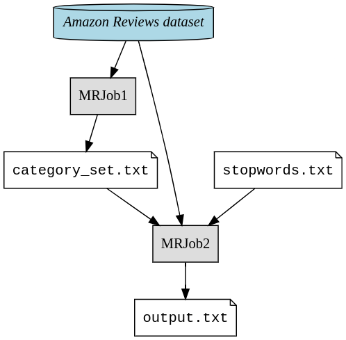
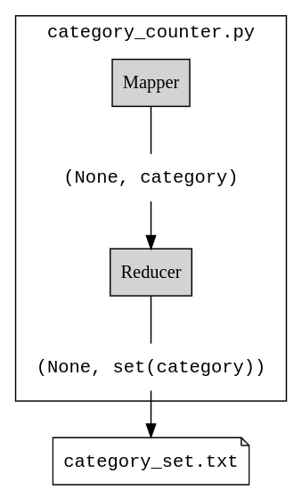
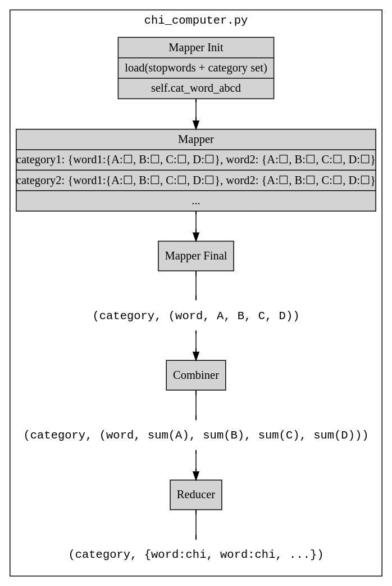

```{r setup, include=FALSE}
knitr::opts_chunk$set(echo = TRUE)
```

# Introduction

In this Exercise, the mission is to find the most discriminative words in each 
category by going through [Amazon Review Dataset 2014](https://cseweb.ucsd.edu/~jmcauley/datasets/amazon/links.html) which contains millions of reviews on 22 product categories by calculating the value 
of \( \chi^2_{tc} \) for these words.


Chi-square is a statistical measure commonly used in data analysis to assess the 
association between categorical variables. It determines whether there is a 
significant difference between the expected and observed frequencies of a 
categorical variable.

In this project, chi-square is used to evaluate the significance of each term in 
discriminating between different product categories based on their occurrence 
in reviews. By calculating the chi-square value for each term, terms that are 
highly associated with specific categories and are effective discriminators 
can be identified.

By selecting terms with high chi-square values, you can effectively identify 
the most discriminative terms for each category, which is essential for text 
classification tasks. In the end, the final result will contain the top 75 words 
in each category with highest the \( \chi^2_{tc} \) value in a descending order.
To achieve this goal, firstly all the irrelevant terms such as *a*, *an*, *with* 
etc. will be filtered out. then, a MapReduce will be implemented which is required 
for the required calculations. 

MapReduce is a parallel processing framework for handling large datasets across 
a distributed cluster. It operates in two main phases:

* 1.Map Phase: Input data is divided into smaller chunks and processed 
  independently by mapper tasks, which apply a specified operation to generate 
  intermediate key-value pairs.
* 2.Reduce Phase: Intermediate results are shuffled, grouped, and processed by 
  reducer tasks, which apply another operation to produce the final output.

Also,`mrjob` library has been used for the implementation of MapReduce job to 
simplify the pre-processing part and running the code on cluster.mrjob library, 
helps efficiently implement the pre-processing steps required for text 
classification steps, such as tokenization, case folding, stop-word filtering 
and calculating chi-square values for discriminating terms. Additionally, mrjob 
facilitates solid integration with Hadoop clusters, ensuring scalability and 
performance when processing large datasets.

# Problem Overview

The full task involves processing a large text corpus to select discriminative 
terms for text classification. The main challenges to deal with in this 
task are efficient data processing to calculate chi-square values and implementing
the code in a way which is both fast and optimized and also accurate.

chi-squared values will be calculated using the following formula:


$$ \chi^2_{tc} = \frac{N(AD - BC)^2}{(A + B)(A + C)(B + D)(C + D)} $$


The values of $A$, $B$, $C$, $D$ and $N$ are defined as follows:

* $A$: Frequency of term in the same category
* $B$: Frequency of term in different categories
* $C$: Frequency of non-term in the same category
* $D$: Frequency of non-term in different categories
* $N$: Total Number of Documents or category frequency(total)

in other words:

* $A$: tc_dictionary[term][category]
* $B$: sum(tc_dictionary[term].values()) - A
* $C$: category_frequency[category] - A
* $D$: total_category_reviews - A - B - C
* $N$: A + B + C + D

MapReduce is a crucial part of this task as it helps efficiently process the Dataset 
to select discriminative terms for text classification by enabling the following 
features:

* 1.Scalability: It enables parallel processing of the massive dataset across 
  multiple cluster nodes.
* 2.Efficiency: By dividing the workload and distributing it, MapReduce reduces 
  processing time.
* 3.Parallelism: Concurrent execution of map and reduce tasks maximizes resource 
  utilization and speeds up computation.
* 4.Fault Tolerance: Built-in fault tolerance mechanisms ensure reliable 
  execution, even in the presence of node failures.

# Approach and Methodology

```{r, echo=FALSE, out.width="50%", fig.align='center', fig.cap="High level pipeline"}

```

Our approach to solving the task involves four key steps:

## Pre-processing:

the solution starts with pre-processing the text data to ensure consistency and 
remove irrelevant words. This includes tokenization, case-folding to convert 
all text to lowercase, and filtering using a predefined list of stopwords from 
stopwords.txt.

Additionally, stemming was used as an extra step. Stemming reduces words to 
their root form, aiding in accurate term matching and reducing the vocabulary 
size, which enhances efficiency.

## Category Identification:
Using the category_counter.py script, unique categories present in the dataset 
were identified. 
This step helps understanding the distribution of reviews across different 
product categories.

## Chi-Square Calculation:

In this step, the frequency of each category was counted and chi-square values 
for each term in the dataset were calculated to identify terms that discriminate 
well between categories.
The chi_computer.py script is responsible for this computation:

* Mapper: Pre-processes each line of input, tokenizes the review text, removes 
  unnecessary words based on stopwords.txt, and performs stemming. The mapper 
  emits key-value pairs with the category as the key and words as the value.
  
* Combiner and Reducer: Aggregate word counts and calculate chi-square values 
  for each word in each category. The resulting chi-square values are sorted in 
  descending order, and the top 75 terms per category are preserved.
  
## Running the Code:

To execute the code:

* Run category_runner.py to count category occurrences and print a text file 
  containing the unique categories in the dataset.
  
```{r, echo=FALSE, out.width="30%", fig.align='center', fig.cap="Category Counter"}

```
  
`category_runner.py`: calls the `category_counter.py` job to count category 
occurrences and print a text file which contains the unique categories in the 
document.
  
* execute runner_chi.py.py to compute chi-square values and generate the output 
  file output.txt containing the top discriminative terms for each category.
  
```{r, echo=FALSE, out.width="30%", fig.align='center', fig.cap="Chi Computer"}

```

`runner_chi.py`: calls the `chi_computer.py`, for calculating chi-square values, and 
generates output in the specified format (`output.txt`).


# Conclusion

In conclusion, our approach effectively<!--No, not very effectively --> addresses the task of 
selecting discriminative terms for text classification using MapReduce and mr-Job. 
By preprocessing the data, counting category occurrences, and calculating 
\( \chi^2_{tc} \) values, we identified terms that exhibit significant 
differences between categories.


